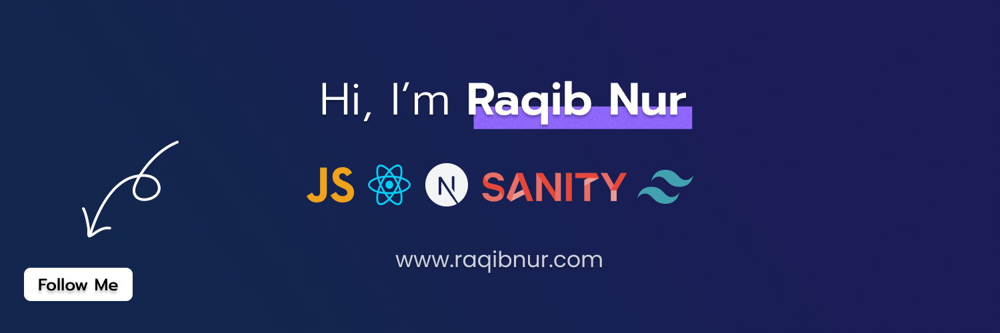
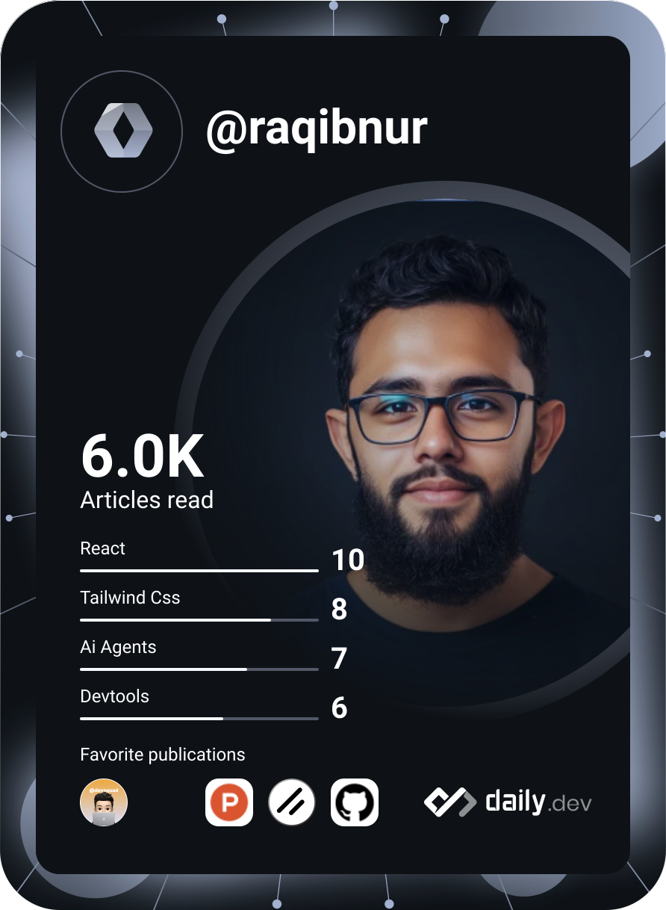

  

  
  
  
  
  

---

### 👋 Hey, I'm Raqib

I run **[The Run Digital](https://therundigital.com)**, a web agency working out of Dhaka 🇧🇩 and Quebec 🇨🇦. We build sites and lead systems for home-service and contracting businesses.

After hours I ship my own products, mostly through a multi-agent Claude Code workflow.

### 🛠 Currently building

<table>
  <tr>
    <td width="33%" valign="top">
      <h4>🧩 WPable</h4>
      A macOS app for building WordPress sites with AI agents. Local install, agent builds, one-click sync to live.
        
      
    </td>
    <td width="33%" valign="top">
      <h4>🛰 <a href="https://github.com/raqibnur/localfly">Localfly</a></h4>
      Share localhost from your Mac in one click. A menu-bar ngrok alternative with self-hosted HTTPS.
        
      
      
    </td>
    <td width="33%" valign="top">
      <h4>✨ <a href="https://hoverui.com">HoverUI</a></h4>
      Open-source hover-effect components, shipped as a shadcn registry. PRs and ideas welcome.
        
      
    </td>
  </tr>
  <tr>
    <td width="33%" valign="top">
      <h4>🕌 <a href="https://minarah.app">Minarah</a></h4>
      A native SwiftUI menu-bar app that reminds you to pray during long screen sessions.
        
      
    </td>
    <td width="33%" valign="top">
      <h4>📡 WP Monitor</h4>
      One dashboard for a fleet of WordPress sites: plugin &amp; theme updates, bulk runs with dry-run, backups and one-click rollback.
        
      
    </td>
    <td width="33%" valign="top" align="center">
      <h4>🔭 More soon</h4>
      Small tools, shipped in public.
        
      
    </td>
  </tr>
</table>

### 🧭 Stack &amp; activity

<table>
  <tr>
    <td valign="middle" align="center" width="580">
      
       
      🌐 Web &nbsp;·&nbsp; 🧱 WordPress &amp; PHP &nbsp;·&nbsp; 🍎 Native macOS &nbsp;·&nbsp; 🧰 Tooling
    </td>
    <td valign="middle" align="center" width="270">
      
       
      📚 On daily.dev for 2+ years
    </td>
  </tr>
  <tr>
    <td colspan="2" align="center">
      
    </td>
  </tr>
</table>

💬 Ask me about WordPress &amp; headless builds · Next.js · SwiftUI · AI-agent dev workflows · agency ops

